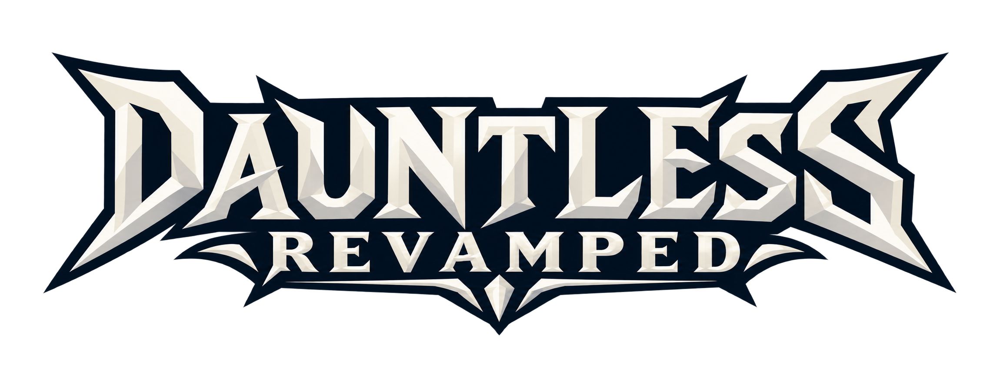

  

  <b>A community-run revival of Dauntless.</b> 
  Launcher, game backend and server runtime that bring Dauntless 1.14.7 back online after the official shutdown.

  <a href="https://github.com/HyjinnxDev/dauntless-revamped-releases/releases/latest"><b>Download the launcher</b></a> ·
  <a href="https://discord.gg/HpgNEmVbBb"><b>Join the Discord</b></a> ·
  <a href="https://hyjinnx.com/revamped">Website</a>

  
  
  
  

> [!IMPORTANT]
> Dauntless Revamped is an unofficial fan project. It is not affiliated with, endorsed by or sponsored by
> Phoenix Labs, Epic Games or any current or former Dauntless rights holder. This repository contains
> **source code only**: no game files, game data or generated SDK.

## Playing

1. Download and run the latest **Dauntless Revamped** installer from the
   [releases page](https://github.com/HyjinnxDev/dauntless-revamped-releases/releases/latest).
2. Get an invite to a server (ours is shared on the [Discord](https://discord.gg/HpgNEmVbBb)) and open it in the launcher.
3. Create an account. The launcher downloads Dauntless 1.14.7, checks every file, and keeps itself and the
   game runtime up to date.

Windows 10 or 11 (64-bit) is required.

## What's in it

- **Launcher**: one-click install of the 1.14.7 client, file verification, signed self-updates, accounts,
  server list with live status, news from Discord.
- **Backend**: accounts, characters, inventory, crafting, store and currencies, Hunt Pass, mastery, Slayer's
  Path, bounties, guilds, parties and in-game chat.
- **Game servers**: Ramsgate, the Training Dojo, hunts, escalations and the Gauntlet, with public
  matchmaking and joining a friend's hunt in progress.
- **Runtime**: the compatibility layer loaded into the game, adding party voice chat (push-to-talk and
  proximity voice in Ramsgate), behemoth health bars and a cinematic camera.
- **Operations**: staff console with moderation tools, automatic crash reports and a Discord bot for server
  status, issue tickets and launcher news.

## Repository layout

| Path | What |
|---|---|
| [`launcher/`](launcher) | Dauntless Revamped launcher (Electron, TypeScript) |
| [`versions/1.14.7/ParadoxBackend`](versions/1.14.7/ParadoxBackend) | Game backend: HTTPS API, XMPP chat, voice relay, staff console (Node.js, MongoDB) |
| [`versions/1.14.7/ParadoxDirector`](versions/1.14.7/ParadoxDirector) | Starts and supervises Ramsgate, Dojo and hunt servers |
| [`versions/1.14.7/ParadoxRuntime`](versions/1.14.7/ParadoxRuntime) | `MysticParadox.dll`, the in-game runtime (C++) |
| [`discord-bot/`](discord-bot) | Discord bot: status channel, `/issue` tickets, launcher news |
| [`deploy/`](deploy) | Moving the server stack to another machine |
| `launcher-bridge/` | Hand-over launcher that moves old Dauntless Forever installs to Revamped |

## Running a server

The server runs on Windows x64 and needs your own lawful Dauntless 1.14.7 installation, from which the game
data and SDK are generated locally (they are never distributed here). Start with
[the self-hosting guide](versions/1.14.7/docs/SELF_HOSTING.md); [`deploy/README.md`](deploy/README.md) covers
running the stack on a second machine.

## Security

Please report vulnerabilities privately through
[GitHub security advisories](https://github.com/HyjinnxDev/dauntless-revamped/security/advisories/new)
rather than a public issue. See [SECURITY.md](versions/1.14.7/SECURITY.md).

## Credits and license

Dauntless Revamped stands on the work of others, and keeps their licenses and notices:

- [Mystic Paradox](https://github.com/pranav158/Mystic-Paradox): the self-hosted server stack for 1.14.7.
- [Dauntless Revived](https://github.com/mixutin/dauntless-revived): the launcher and server work this grew from.
- [Undaunted](https://github.com/SyST3MDeV/Undaunted): the original reverse-engineered backend.

Licensed under the [GNU Affero General Public License v3.0](versions/1.14.7/LICENSE) (AGPL-3.0-only). If you
run a modified version for others, you must offer them its source code.

Dauntless and related names and marks are trademarks of their respective owners.
